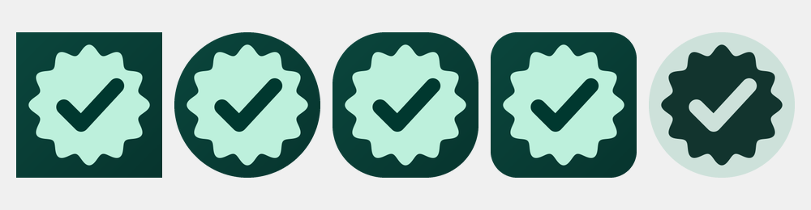

# Anjiz <sub>(أنجِز)</sub>

An offline-first, **Material 3 Expressive** to-do app for Android — with
home-screen widgets that feel like Google Tasks.

Everything lives on-device (SQLite via Drift); there is no account and no
network. Dynamic colour, spring motion, a scalloped task checkbox and adaptive
layouts (phone → tablet) come from the shared `anjiz_ui` design system.

<p align="left">
  
</p>

## Features

- **Today** — greeting banner plus a focused agenda of due and starred tasks.
- **Upcoming** — a date strip and per-day agenda with a momentum summary.
- **Lists** — colour-coded lists with per-list counts and a daily milestone.
- **Tasks** — due date/time, priority, notes, subtasks, recurrence (repeat
  rule), stars and completion.
- **Reminders** — local notifications scheduled ahead of a task's due time,
  rebuilt after reboot.
- **Search** — full-screen search across titles and notes.
- **Settings** — a nested hub: General (theme mode, dynamic colour, accent tone,
  pure black (OLED), motion/haptics), Notifications & Widgets (daily briefing,
  widget configuration), Data & Backup and About. Every row names its current
  value, and each section opens its own screen without leaving the tab.
- **Home-screen widgets** — tasks overview (4×4 / compact 4×2), progress
  (2×2) and quick add (4×1), with tap-to-complete and Material You colours.
- **Floating glass navigation bar** — the bottom bar hovers over the content on
  a backdrop-blurred pill (`AnjizFloatingNavBar`).
- **Over-the-air updates** — the app checks the release manifest on launch, and
  Settings → App update downloads the new APK and hands it to Android's
  installer, with the release notes rendered in-app.
- **RTL-aware** and light/dark, with an accessible design system.

## Requirements

- Flutter **3.47+** / Dart **3.13+** (Dart workspaces).
- Android toolchain for building: JDK 17, Android SDK (compile SDK from Flutter).
- Optional dev tooling: [`just`](https://github.com/casey/just),
  `python3` + `rsvg-convert` (only for regenerating the icon).
  Release builds additionally use `keytool` (JDK) and the SDK's `apksigner`.

## Getting started

```sh
flutter pub get
just gen          # or: flutter gen-l10n && dart run build_runner build --delete-conflicting-outputs
flutter run
```

`just` wraps the common tasks:

| Command | What it does |
| --- | --- |
| `just pub-get` | `flutter pub get` |
| `just gen` | Regenerate l10n + generated code |
| `just analyze` | `flutter analyze` (must be clean) |
| `just test-all` | App + `anjiz_ui` test suites |
| `just format` | `dart format .` |
| `just icons` | Rasterise icons, check the safe zone + regenerate launcher resources |
| `just icon-check` | Verify the launcher layers survive every Android mask |
| `just apk` / `just appbundle` | Build Android artefacts |
| `just release` | Build, sign and stage the release APKs under `dist/` |
| `just version` | Print the tag/version/versionCode derived from `pubspec.yaml` |
| `just run-linux` / `just run-android` | Run on the Linux desktop / an Android device |
| `just check` | Format, analyse and test — the pre-PR gate |

Run `just` on its own to list every recipe.

### Running on Linux desktop

The app also builds for Linux desktop, which is a fast way to iterate on the UI
without an emulator:

```sh
just run-linux
```

This is a **development convenience only** — AGENTS.md targets Android first.
Three plugins are Android/iOS-only and are compiled out on desktop:
`flutter_local_notifications`, `home_widget` and `workmanager`. The services that
own them (`NotificationService`, `WidgetSyncService`, `BackgroundRefreshScheduler`)
check `PlatformSupport` (`lib/core/utils/platform_support.dart`) and become
no-ops, so reminders and home-screen widgets do not work in the desktop build.
Everything else — Drift storage, tasks, lists, search, settings, dynamic colour —
runs normally.


## Architecture

Layered, offline-first, with a strict dependency direction:

```
features  ──▶  domain  ◀──  data
   │              ▲
   └──────────────┴──  anjiz_ui · core
```

```
lib/
├── app/          # bootstrap, router, shell, DI wiring
├── core/         # constants, errors, extensions, services, utils
├── domain/       # pure Dart: entities, repositories, use cases, service ports
├── data/         # Drift database, DAOs, mappers, repository implementations
├── features/     # today · upcoming · lists · task_detail · add_task
│                 # search · settings · onboarding
└── l10n/         # ARB files (English)
packages/anjiz_ui # shared Material 3 Expressive design system
android/          # app + native Jetpack Glance widgets (Kotlin)
linux/            # desktop target for local UI development (not a ship target)
tool/             # icon pipeline + safe-zone checker
.github/          # CI gate + signed release workflow
```

Key rules (see [AGENTS.md](AGENTS.md) for the full contract):

- **UI primitives live only in `anjiz_ui`.** Features compose them; they never
  invent new buttons/cards/rows.
- **`domain` is pure Dart** — no Flutter imports. Platform concerns enter
  through ports (`WidgetSyncer`, `ReminderScheduler`).
- **Features never import `data`.** Repository interfaces live in `domain`.
- **No hard-coded colours, sizes or strings** — use `AnjizSpacing`,
  `AnjizShapes`, `AnjizMotion`, theme tokens and l10n.
- **Small files** — target ≤150 lines, hard cap 250.

State is Riverpod; routing is `go_router`; entities are Freezed; persistence is
Drift (single source of truth).

## Home-screen widgets

Native Android widgets are written with **Jetpack Glance** and fed a JSON
snapshot by `WidgetSyncService` — the only component allowed to push widget
data. Widgets in `com.freesoftware.anjiz.widget`:

| Widget | Size | Contents |
| --- | --- | --- |
| `TasksOverviewWidget` | 4×4 (→ 4×2 compact) | List switcher, add button, up to 6 tasks, "+N more", empty state |
| `ProgressWidget` | 2×2 | Determinate progress + `done/total` |
| `QuickAddWidget` | 4×1 | One-tap composer launch |

Tap-to-complete runs in a background isolate
(`lib/app/widget_background.dart`) → updates the database → refreshes every
widget. A WorkManager job (`lib/core/services/background_refresh.dart`)
re-syncs widgets and reschedules reminders after a reboot and at day boundaries.

Colours come from `GlanceTheme`, which maps to `@android:color/system_accent*`
on Android 12+ for Material You; there is no static colour palette to maintain.
Native widget labels live in
`android/app/src/main/res/values/strings.xml` because the widget process cannot
reach Flutter's ARB localisations.

Configure a widget via the in-app **Widget configuration** screen (list,
completed visibility, opacity).

## Releases & OTA updates

Anjiz updates itself: installed builds check a manifest, download the release
APK and hand it to Android's package installer (`ota_update`, via
`UpdateService`). The pieces:

| Piece | Where |
| --- | --- |
| Version (single source of truth) | `version:` in `pubspec.yaml` |
| Android `versionCode` | `major*10000 + minor*100 + patch` — `android/app/build.gradle.kts` |
| Same formula in Dart | `AppInfo.versionCodeOf` (`lib/core/services/app_info.dart`) |
| Same formula in the build | `build.sh --detect-version` |
| Published manifest | `update_manifest.json` (read from `raw.githubusercontent.com`) |
| Build/sign/stage | `build.sh` → `dist/*.apk` + `checksums.txt` |
| CI | `.github/workflows/ci.yml` (PR gate), `release.yml` (signed release) |
| In-app updater | `lib/core/services/update_service.dart`, Settings → App update |

`build.sh` derives the tag, version and versionCode from `pubspec.yaml`, builds
one APK per supported ABI plus a **universal** APK (the one the in-app updater
always downloads), signs everything with the stable release keystore and
verifies each signature with `apksigner` before staging it under `dist/`
(gitignored).

### Releasing

1. Bump `version:` in `pubspec.yaml`.
2. Add a `## [<version>]` section to `CHANGELOG.md` (the workflow fails without
   it: released notes are never guessed).
3. Merge to `main`. `.github/workflows/release.yml` then builds, signs, uploads
   the APKs to a `v<version>` GitHub release, rewrites `update_manifest.json`
   with the universal APK's URL + sha256, verifies the uploaded bytes match the
   manifest, and commits the manifest back to `main`. That commit is what makes
   the release visible to installed apps.

### Repository secrets

Release builds must be signed with the **same keystore forever** — Android
refuses to update an app whose signature changed. Configure these before the
first merge to `main` (the workflow fails rather than ship an unsigned APK):

| Secret | Value |
| --- | --- |
| `ANJIZ_KEYSTORE_BASE64` | `base64 -w0 anjiz-release.jks` |
| `ANJIZ_KEYSTORE_PASSWORD` | keystore password |
| `ANJIZ_KEY_ALIAS` | signing key alias |
| `ANJIZ_KEY_PASSWORD` | signing key password |

Locally, `just release` uses `android/key.properties` when present (gitignored)
and otherwise falls back to Android's debug key — enough to smoke-test a release
build, never to publish.

### How the update is offered

- On launch the app checks the manifest at most once every six hours, silently:
  an offline check is never an error the user sees.
- A newer `latestVersionCode` posts a one-off notification and lights up the
  Settings → **App update** row ("Version 1.0.1 is ready").
- The update screen shows the installed version, the release notes from
  `CHANGELOG.md`, download progress and the install action. Android asks once to
  allow Anjiz to install unknown apps; the permission failure is explained
  in-app instead of being a dead end.

## Icons

Vector sources live in `assets/icons/`; the PNG layers consumed by
`flutter_launcher_icons` are generated by a reproducible script:

```sh
just icons     # tool/render_icons.sh + dart run flutter_launcher_icons
```

See [`assets/icons/README.md`](assets/icons/README.md) for details. The adaptive
icon includes a `<monochrome>` layer for Android 13+ themed icons, and
`tool/check_icon_safe_zone.py` (`just icon-check`) fails when a layer drifts
outside the 66dp safe zone every launcher mask guarantees.

## Testing

```sh
just test-all   # flutter test  +  cd packages/anjiz_ui && flutter test
```

Unit tests cover the domain use cases, mappers, formatting helpers and the
design-system widgets, plus regression tests for the layouts that used to
overflow (the tasks-overview app bar, the Lists stat strip and the list-summary
card) — one of them is the reason the Lists screen no longer crashes inside a
sliver. Run `just analyze` — the project is kept at **zero** analyzer issues.

Because the Android-only plugins degrade to no-ops on desktop, widget tests can
run under `flutter test` without platform channels, and `just run-linux` is the
quickest way to eyeball UI changes.

## Contributing

See [CONTRIBUTING.md](CONTRIBUTING.md). In short: branch from `main`, keep the
architecture rules above, run `just check`, and update
[CHANGELOG.md](CHANGELOG.md).

## License

See [LICENSE](LICENSE).
